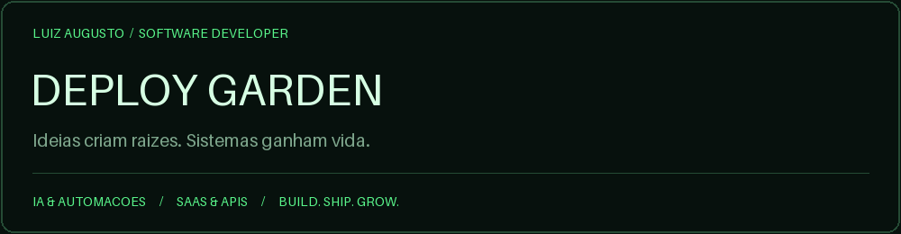
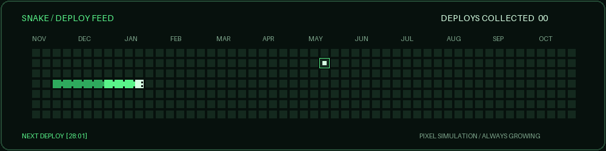

  

  <a href="https://github.com/Luizaug1">GitHub</a> ·
  <a href="https://www.linkedin.com/in/luiz-augusto-dev/">LinkedIn</a>

<strong>Construir com intenção. Entregar com consistência. Evoluir sempre.</strong>

  

Um jardim de entregas, um deploy por vez. Animação ilustrativa; os pontos não representam deploys ou contribuições reais.

## 🌱 Quem cultiva este jardim

Sou **Luiz Augusto**, desenvolvedor brasileiro focado em **IA, automações, SaaS e integrações**. Transformo ideias em aplicações utilizáveis, conectando sistemas e simplificando processos.

Uso inteligência artificial ao longo do desenvolvimento, com atenção ao que sustenta uma boa entrega: entender o problema, validar decisões, testar e acompanhar o sistema em produção.

## 🟩 O que eu construo

| Frente | Da ideia à entrega |
| :--- | :--- |
| **Automações & bots** | Fluxos inteligentes, tarefas recorrentes e integrações com IA. |
| **SaaS & plataformas** | Aplicações multi-tenant, assinaturas e controle de acesso. |
| **APIs & integrações** | Serviços conectados por APIs, webhooks e eventos. |
| **Pagamentos** | Integrações de cobrança e fluxos de pagamento. |
| **Operação** | Segurança, logs, testes, performance, backup e rollback. |

## 🌿 Como as ideias crescem

**01 Entender** → **02 Planejar** → **03 Construir** → **04 Validar** → **05 Entregar** → **06 Evoluir**

Cada etapa tem um propósito: resolver o problema certo e manter espaço para o próximo crescimento.

## 🐍 Por trás dos pixels

A cobrinha encontra caminhos, coleta um ponto e busca o próximo em outra posição. A trajetória forma um ciclo contínuo, sem apagamento ou corte no reinício.

O GIF funciona diretamente no GitHub, sem serviços externos. O gerador e as instruções para personalizar a animação estão em [`assets/`](./assets/README.md).

---

<strong>Vamos cultivar a próxima ideia?</strong> 
<a href="https://www.linkedin.com/in/luiz-augusto-dev/">Converse comigo no LinkedIn</a> · <a href="https://github.com/Luizaug1?tab=repositories">Explore meus repositórios</a>

DEPLOY GARDEN · Luiz Augusto · build / ship / grow

