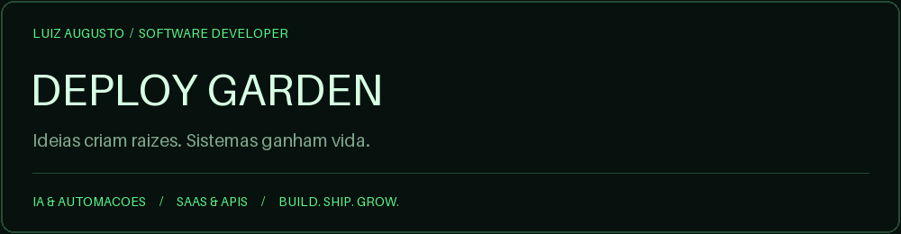
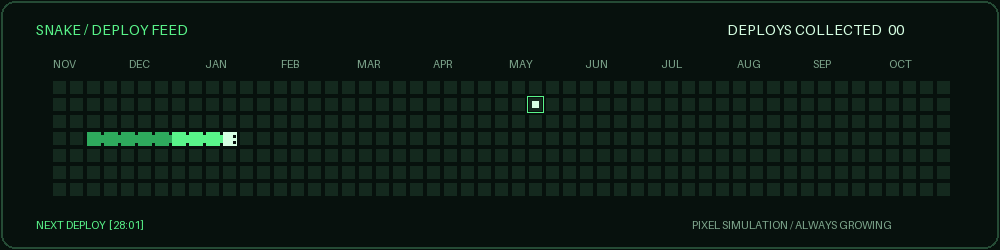

  

  <a href="https://github.com/Luizaug1">GitHub</a> ·
  <a href="https://www.linkedin.com/in/luiz-augusto-dev/">LinkedIn</a>

<h1 align="center">Luiz Augusto</h1>

<strong>Desenvolvimento de software · Automações · Integrações com IA</strong>

## Sobre mim

Sou desenvolvedor brasileiro com foco em **automações, aplicações SaaS e integração de sistemas**. Desenvolvo soluções para conectar serviços, reduzir tarefas manuais e apoiar processos de negócio.

Trabalho com APIs, bots, webhooks, pagamentos e aplicações com múltiplos clientes. Utilizo inteligência artificial como ferramenta de apoio ao desenvolvimento, com revisão das implementações, testes e validação do comportamento esperado.

## Áreas de atuação

| Área | Aplicação |
| :--- | :--- |
| **Automações e bots** | Fluxos de trabalho, tarefas recorrentes e integração entre ferramentas. |
| **Aplicações SaaS** | Plataformas multi-tenant, assinaturas e controle de acesso. |
| **APIs e integrações** | Comunicação entre serviços por APIs, webhooks e eventos. |
| **Pagamentos** | Integrações de cobrança e processamento de notificações de pagamento. |
| **Operação e manutenção** | Logs, tratamento de falhas, acompanhamento e evolução das aplicações. |

## Abordagem de desenvolvimento

- **Entendimento do problema:** definir requisitos, restrições e critérios de aceite antes da implementação.
- **Construção incremental:** dividir entregas em etapas que possam ser verificadas e ajustadas.
- **Qualidade e segurança:** considerar testes, controle de acesso, tratamento de erros e proteção de dados.
- **Continuidade da operação:** planejar implantação, monitoramento, backup e rollback conforme as necessidades do projeto.

## Projetos e contato

Os repositórios públicos reúnem projetos, estudos e experimentos de desenvolvimento. Para conhecer o código e a documentação, acesse [meus repositórios](https://github.com/Luizaug1?tab=repositories).

Para conversar sobre projetos, integrações ou oportunidades de colaboração, entre em contato pelo [LinkedIn](https://www.linkedin.com/in/luiz-augusto-dev/).

---

  

Deploy Garden · Animação ilustrativa inspirada na grade de contribuições do GitHub.

Sobre a animação

A animação é um elemento visual do perfil e não representa deploys ou contribuições reais. Os arquivos e a documentação estão em [`assets/`](./assets/README.md).

